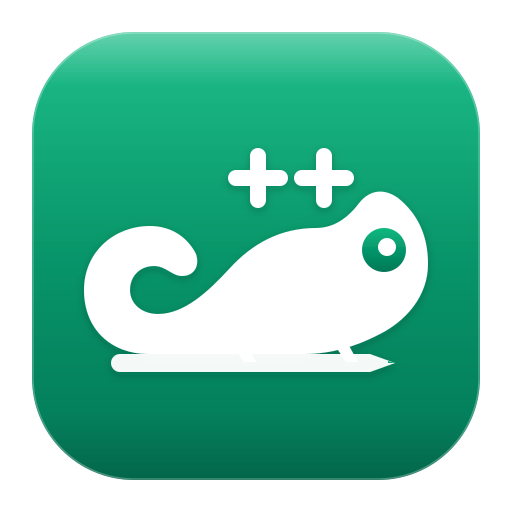

<p align="center">
  
</p>

<h1 align="center">catatan++</h1>

<p align="center">
  <strong>Native Apple Silicon macOS port of the Notepad++ editing engine.</strong><br>
  <em>No Wine. No Rosetta. No emulation. Pure 64-bit ARM Cocoa / AppKit.</em>
</p>

<p align="center">
  
  
  
  
</p>

---

## 📖 Tentang catatan++

**catatan++** adalah aplikasi text editor native untuk macOS berbasis engine penyunting dan pewarnaan sintaks legendaris **Notepad++** ([Scintilla](https://www.scintilla.org/) & [Lexilla](https://www.scintilla.org/Lexilla.html)).

Notepad++ asli di Windows menggunakan ~158k baris kode Win32 / MFC yang tidak dapat dikompilasi di macOS. **catatan++** mempertahankan seluruh kecanggihan engine teks Scintilla dan 142 lexer bahasa Lexilla, tetapi mengganti total cangkang Win32 dengan antarmuka native macOS (**Cocoa / AppKit**) yang ringan, cepat, dan hemat daya.

Menghasilkan aplikasi mandiri `Catatan++.app` berukuran ramping (~4.0 MB) dengan performa instan di Apple Silicon (M1/M2/M3/M4).

---

## ✨ Fitur Utama

- ⚡ **Performa Native Apple Silicon:** Kompilasi native `arm64`, konsumsi memori sangat hemat dan buka file instan.
- 📑 **Tab Multi-Dokumen:** Manajemen tab kustom dengan penutupan cepat, indikator perubahan (*dirty* `*`), dan pintasan keyboard (⌘W, ⌘⇧], ⌘⇧[).
- 🎨 **96 Bahasa & 142 Lexer Sintaks:** Pewarnaan sintaks kaya menggunakan aturan resmi Notepad++ (`langs.model.xml`) dan palet tema (`stylers.model.xml`) dengan deteksi otomatis 242 ekstensi file.
- 🛠️ **32 Tombol Toolbar Lengkap:** Meniru persis urutan dan fungsi 32 toolbar asli Notepad++ dengan ikon vektor SVG tajam.
- 🗂️ **Sidebar Terintegrasi:**
  - **Document List:** Melihat dan beralih cepat antar tab yang aktif.
  - **Folder as Workspace:** Penjelajah folder disk lokal.
  - **Function List:** Navigasi cepat ke definisi fungsi (C/C++, Python, Lua, Swift, Go, Rust, Java, JS/TS, PHP, dll).
  - **Document Map:** Ringkasan struktur dokumen.
- 🪟 **Split View & Sinkronisasi Scroll:** Buka dokumen berdampingan dengan opsi sinkronisasi gulir vertikal dan horizontal.
- 📡 **File Monitoring (`tail -f`):** Memantau pembaruan file log secara langsung (*live monitoring*).
- ⏺️ **Macro Recording & Playback:** Merekam aksi ketikan, menjalankan berulang kali, dan menyimpan dalam format `shortcuts.xml`.
- 🖨️ **Pencetakan Terpaginasi:** Sistem cetak mandiri terpaginasi per baris dengan penomoran halaman rapi.

---

## 🏗️ Cara Build dari Source

### Kebutuhan Sistem
- macOS 11.0 (Big Sur) atau lebih baru (Apple Silicon).
- Xcode Command Line Tools (`xcode-select --install`). Tidak membutuhkan dependensi pihak ketiga (tanpa CMake, Ninja, atau Homebrew).

### Langkah Kompilasi
```bash
# Masuk ke direktori macport
cd macport

# Jalankan skrip build
./build.sh

# Buka aplikasi yang telah terkompilasi
open dist/Catatan++.app
```

### Menjalankan Self-Test Otomatis
```bash
dist/Catatan++.app/Contents/MacOS/Catatan++ --selftest
```
Suite pengujian bawaan menguji 66 assertion mencakup: pemetaan sintaks 96 bahasa, siklus tab dokumen, perilaku baris aktif, semua 32 tombol toolbar, panel sidebar, split-view scroll sync, dan rekaman makro.

---

## 🏛️ Arsitektur Proyek

| Komponen | Sumber | Keterangan |
|---|---|---|
| **Text Engine (Scintilla)** | `src/scintilla/src` + `src/scintilla/cocoa` | Engine penyunting teks multiplatform dengan backend Cocoa bawaan |
| **Syntax Highlighting (Lexilla)** | `src/lexilla/lexers` | 141 file lexer pendukung 142 bahasa pemrograman |
| **Data Bahasa & Tema** | `macport/tools/gen.py` | Mengekstrak definisi XML hulu menjadi tabel C/Obj-C (`Keywords.c`, `Theme.c`, `LexerMap.m`) |
| **Cangkang GUI macOS** | `macport/src` | Ditulis ulang dalam Cocoa / AppKit (Window, Toolbar, Sidebar, Tabs, Actions) |

---

## 🙏 Credits & Acknowledgements

Proyek **catatan++** berdiri di atas dedikasi luar biasa komunitas open-source:
- **[Notepad++](https://notepad-plus-plus.org/) & Don Ho:** Untuk karya legendaris, tata letak toolbar, definisi bahasa (`langs.model.xml`), dan tema pewarnaan sintaks (`stylers.model.xml`).
- **[Scintilla](https://www.scintilla.org/) & Neil Hodgson:** Untuk engine penyunting teks berperforma tinggi dan backend Cocoa bawaan.
- **[Lexilla](https://www.scintilla.org/Lexilla.html):** Untuk 142 lexer pewarnaan sintaks bahasa pemrograman.
- **[Solar Icons](https://solar-icons.dev/):** Untuk ikon vektor yang digunakan pada toolbar antarmuka.

---

## 📄 Lisensi

Proyek ini menggunakan kode hulu dari [Notepad++](https://github.com/notepad-plus-plus/notepad-plus-plus), Scintilla, dan Lexilla yang berlisensi **GNU General Public License v3 (GPLv3)**.

Sesuai dengan ketentuan GPLv3:
- Seluruh kode sumber turunan dilisensikan secara terbuka di bawah GPLv3.
- Nama dan identitas proyek diubah menjadi **catatan++** untuk menghormati merek dagang Notepad++.
